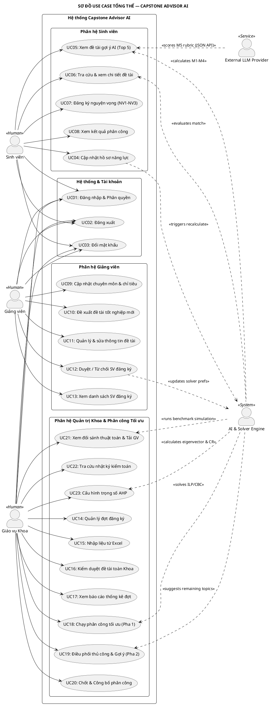
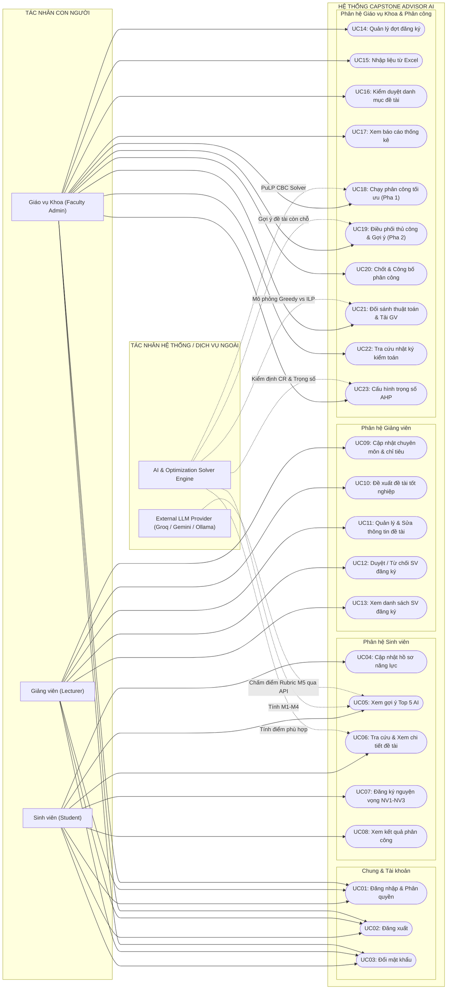

# Đặc tả 23 Use Case & 5 Tác nhân Hệ thống Capstone Advisor AI

> **Dành cho:** Anh Trịnh Hoàng Thành (vibe code thực chiến, chuẩn bị bảo vệ đồ án tốt nghiệp)  
> **Tài liệu đặc tả:** Mô hình chức năng hệ thống chuẩn UML gồm 5 Tác nhân (Actors), 23 Use Case (UC01–UC23), kèm bảng đặc tả chi tiết, sơ đồ PlantUML và sơ đồ Mermaid.

---

## PHẦN 1: MÔ HÌNH HÓA 5 TÁC NHÂN HỆ THỐNG (ACTORS)

Hệ thống **Capstone Advisor AI** tương tác với **5 tác nhân** (bao gồm 3 tác nhân con người và 2 tác nhân dịch vụ/hệ thống):

| STT | Tác nhân (Actor) | Bản chất | Vai trò & Trách nhiệm chính |
|:---:|---|:---:|---|
| **1** | **Sinh viên (Student)** | Người dùng (Human) | Cập nhật hồ sơ năng lực (kỹ năng, môn học, lĩnh vực, tự giới thiệu); nhận danh sách Top 5 đề tài gợi ý kèm giải thích; tra cứu danh mục đề tài; đăng ký và sắp xếp 3 nguyện vọng (NV1–NV3); tra cứu kết quả phân công chính thức. |
| **2** | **Giảng viên (Lecturer)** | Người dùng (Human) | Quản lý hồ sơ chuyên môn và chỉ tiêu hướng dẫn; đề xuất và cập nhật đề tài tốt nghiệp (kỹ năng yêu cầu, môn tiên quyết, sức chứa); theo dõi danh sách sinh viên đăng ký; duyệt (Đồng ý / Từ chối) nguyện vọng của sinh viên. |
| **3** | **Giáo vụ Khoa (Faculty Admin)** | Người dùng (Human) | Quản lý các đợt đăng ký đồ án; nhập liệu hàng loạt danh mục từ file Excel; kiểm duyệt đề tài toàn khoa; cấu hình bộ trọng số đánh giá AHP; thực thi chạy phân công tự động (ILP/Greedy); điều phối Pha 2 cho sinh viên chưa xếp; chốt và công bố kết quả; xem báo cáo thống kê và audit log. |
| **4** | **Hệ thống AI & Bộ giải Tối ưu (AI & Solver Engine)** | Tác nhân hệ thống (Internal System) | Chạy ngầm thực thi các thuật toán lõi: Lọc cứng BR1; tính toán điểm gợi ý $M_1–M_4$; tạo vector nhúng MiniLM; mô hình hóa và giải bài toán Quy hoạch nguyên tuyến tính (ILP PuLP/CBC); tính toán 7 chỉ số metrics phân công; tự động gợi ý đề tài còn chỗ ở Pha 2. |
| **5** | **Dịch vụ LLM ngoài (External LLM Provider)** | Dịch vụ ngoài (External Service) | Cung cấp giao diện API tương thích OpenAI (Groq / Gemini / Ollama) để thực hiện đánh giá chuyên sâu đề tài theo Rubric 100 điểm ($M_5$) và sinh lời nhận xét định tính minh bạch cho sinh viên. |

---

## PHẦN 2: BẢNG DANH MỤC 23 USE CASE (UC01 – UC23)

| Mã UC | Tên Use Case | Tác nhân chính | Tác nhân hỗ trợ | Mức ưu tiên |
|:---:|---|---|---|:---:|
| **UC01** | Đăng nhập hệ thống & Phân quyền | Tất cả người dùng | — | P0 |
| **UC02** | Đăng xuất hệ thống | Tất cả người dùng | — | P0 |
| **UC03** | Đổi mật khẩu cá nhân | Tất cả người dùng | — | P1 |
| **UC04** | Cập nhật hồ sơ năng lực sinh viên | Sinh viên | Hệ thống AI | P0 |
| **UC05** | Xem danh sách đề tài gợi ý AI (Top 5) | Sinh viên | Hệ thống AI, LLM Provider | P0 |
| **UC06** | Tra cứu danh mục & xem chi tiết đề tài | Sinh viên | Hệ thống AI | P0 |
| **UC07** | Đăng ký & sắp xếp nguyện vọng (NV1–NV3) | Sinh viên | Hệ thống AI | P0 |
| **UC08** | Xem kết quả phân công đồ án cá nhân | Sinh viên | — | P0 |
| **UC09** | Cập nhật hồ sơ chuyên môn & chỉ tiêu GV | Giảng viên | Giáo vụ Khoa | P1 |
| **UC10** | Đăng ký đề xuất đề tài tốt nghiệp mới | Giảng viên | — | P0 |
| **UC11** | Quản lý & chỉnh sửa thông tin đề tài | Giảng viên | — | P0 |
| **UC12** | Phê duyệt / Từ chối SV đăng ký đề tài | Giảng viên | Hệ thống AI | P0 |
| **UC13** | Theo dõi danh sách SV đăng ký đề tài | Giảng viên | Hệ thống AI | P1 |
| **UC14** | Quản lý đợt đăng ký đồ án tốt nghiệp | Giáo vụ Khoa | — | P0 |
| **UC15** | Nhập liệu hàng loạt từ file Excel | Giáo vụ Khoa | — | P1 |
| **UC16** | Kiểm duyệt danh mục đề tài toàn Khoa | Giáo vụ Khoa | — | P1 |
| **UC17** | Xem báo cáo thống kê tình hình đăng ký | Giáo vụ Khoa | — | P1 |
| **UC18** | Chạy phân công tối ưu tự động (Pha 1) | Giáo vụ Khoa | Hệ thống AI (ILP Solver) | P0 |
| **UC19** | Điều phối thủ công & Gợi ý vét chỗ (Pha 2) | Giáo vụ Khoa | Hệ thống AI (Solver Pha 2) | P0 |
| **UC20** | Chốt bảng phân công & Công bố kết quả | Giáo vụ Khoa | — | P0 |
| **UC21** | Xem báo cáo so sánh thuật toán & Tải GV | Giáo vụ Khoa | Hệ thống AI | P1 |
| **UC22** | Tra cứu nhật ký kiểm toán (Audit Log) | Giáo vụ Khoa | — | P2 |
| **UC23** | Cấu hình trọng số đánh giá đa tiêu chí AHP | Giáo vụ Khoa | Hệ thống AI (AHP Engine) | P1 |

---

## PHẦN 3: ĐẶC TẢ CHI TIẾT TỪNG USE CASE (UC01 – UC23)

### UC01: Đăng nhập hệ thống & Phân quyền
- **Tác nhân:** Sinh viên, Giảng viên, Giáo vụ Khoa.
- **Mô tả:** Xác thực danh tính người dùng bằng Tên đăng nhập và Mật khẩu. Dựa vào `User.role` để điều hướng tự động về trang chủ chuyên biệt (`home_student`, `home_lecturer`, `home_admin`).
- **Tiền điều kiện:** Người dùng đã có tài khoản trong hệ thống.
- **Luồng chính:**
  1. Người dùng nhập tên đăng nhập và mật khẩu, nhấn Đăng nhập.
  2. Hệ thống xác thực qua Django Authentication Framework.
  3. Hệ thống kiểm tra vai trò:
     - Nếu là Sinh viên $\to$ chuyển hướng tới Dashboard Sinh viên (`home_student.html`).
     - Nếu là Giảng viên $\to$ chuyển hướng tới Dashboard Giảng viên (`home_lecturer.html`).
     - Nếu là Khoa $\to$ chuyển hướng tới Bảng điều khiển Khoa (`home_admin.html`).
- **Ngoại lệ:** Sai tên đăng nhập/mật khẩu $\to$ Báo lỗi "Tài khoản hoặc mật khẩu không chính xác".

### UC02: Đăng xuất hệ thống
- **Tác nhân:** Mọi người dùng đã đăng nhập.
- **Mô tả:** Hủy phiên làm việc (Session), xóa cookie và đưa người dùng về trang đăng nhập.

### UC03: Đổi mật khẩu cá nhân
- **Tác nhân:** Mọi người dùng đã đăng nhập.
- **Mô tả:** Người dùng đổi mật khẩu tài khoản thông qua giao diện Django Password Change chuẩn hóa.
- **Luồng chính:** Nhập mật khẩu hiện tại, nhập mật khẩu mới và xác nhận mật khẩu mới $\to$ Hệ thống kiểm tra độ mạnh mật khẩu $\to$ Cập nhật CSDL và duy trì đăng nhập an toàn.

### UC04: Cập nhật hồ sơ năng lực sinh viên
- **Tác nhân:** Sinh viên (chính), Hệ thống AI (hỗ trợ).
- **Mô tả:** Sinh viên cập nhật mức độ thành thạo các kỹ năng (thang 1–5), mức độ yêu thích các lĩnh vực (thang 1–3), và viết đoạn văn tự giới thiệu bản thân / mục tiêu nghề nghiệp.
- **Luồng chính:**
  1. Sinh viên truy cập `/ho-so/`.
  2. Điền thông tin kỹ năng, lĩnh vực và văn bản giới thiệu.
  3. Bấm "Lưu hồ sơ".
  4. Hệ thống lưu CSDL trong transaction $\to$ Tự động tăng `profile_version` $\to$ Kích hoạt `recommend.engine.score_student` tính lại điểm gợi ý.

### UC05: Xem danh sách đề tài gợi ý AI (Top 5)
- **Tác nhân:** Sinh viên (chính), Hệ thống AI, Dịch vụ LLM ngoài (hỗ trợ).
- **Mô tả:** Sinh viên xem Top 5 đề tài phù hợp nhất được AI gợi ý dựa trên mô hình kết hợp 2 giai đoạn M1–M5.
- **Luồng chính:**
  1. Hệ thống thực thi Giai đoạn 1: Lọc cứng BR1 và tính $M_1–M_4$ lấy Top 15 ứng viên.
  2. Hệ thống thực thi Giai đoạn 2: Gọi LLM (hoặc đọc cache SHA-256) chấm $M_5$ theo Rubric 100 điểm.
  3. Hiển thị Top 5 đề tài kèm huy hiệu điểm phù hợp tổng hợp (0–100%) và bảng chi tiết điểm từng thành phần.
  4. Hiển thị lời giải thích đa tầng (nhận xét của LLM + khuyến nghị kỹ năng cần bổ sung).

### UC06: Tra cứu danh mục & xem chi tiết đề tài
- **Tác nhân:** Sinh viên (chính), Hệ thống AI (hỗ trợ).
- **Mô tả:** Sinh viên tìm kiếm đề tài theo từ khóa, lọc theo lĩnh vực, giảng viên, độ khó; xem chi tiết yêu cầu kỹ năng, môn tiên quyết, sức chứa và điểm tương thích cá nhân.
- **Luồng chính:** Sinh viên truy cập `/danh-sach-de-tai/` $\to$ Chọn bộ lọc $\to$ Click vào đề tài để xem chi tiết $\to$ Hệ thống hiển thị điểm phù hợp của sinh viên với đề tài đó (nếu đã đăng nhập).

### UC07: Đăng ký & sắp xếp nguyện vọng (NV1–NV3)
- **Tác nhân:** Sinh viên.
- **Mô tả:** Trong thời gian đợt đăng ký đang mở (`status = OPEN`), sinh viên chọn 3 đề tài làm Nguyện vọng 1, Nguyện vọng 2, Nguyện vọng 3 (có thể chọn nhanh từ Top 5 gợi ý).
- **Luồng chính:**
  1. Sinh viên vào `/nguyen-vong/`.
  2. Chọn đề tài cho NV1, NV2, NV3 (ràng buộc 3 đề tài phải khác nhau).
  3. Hệ thống hiển thị điểm phù hợp compact cạnh mỗi đề tài được chọn.
  4. Bấm "Lưu nguyện vọng" $\to$ Hệ thống lưu vào bảng `Preference` với trạng thái `PENDING`.
- **Ngoại lệ:** Chọn trùng đề tài giữa các nguyện vọng $\to$ Báo lỗi form validation. Đợt đã đóng $\to$ Khóa form không cho sửa.

### UC08: Xem kết quả phân công đồ án cá nhân
- **Tác nhân:** Sinh viên.
- **Mô tả:** Sinh viên tra cứu đề tài chính thức được Khoa phân công sau khi đợt đăng ký chuyển sang trạng thái `PUBLISHED`.
- **Luồng chính:** Sinh viên đăng nhập vào Dashboard hoặc `/ket-qua/`. Nếu đợt đã công bố, hiển thị thẻ chúc mừng kèm tên đề tài, GVHD, trúng tuyển nguyện vọng mấy, điểm phù hợp. Nếu chưa công bố, hiển thị trạng thái "Hội đồng Khoa đang thẩm định phân công".

### UC09: Cập nhật hồ sơ chuyên môn & chỉ tiêu GV
- **Tác nhân:** Giảng viên (chính), Giáo vụ Khoa (hỗ trợ).
- **Mô tả:** Giảng viên cập nhật bộ môn, lĩnh vực chuyên môn nghiên cứu, và chỉ tiêu hướng dẫn tối đa (`max_students`).
- **Luồng chính:** Giảng viên truy cập `/ho-so-giang-vien/` $\to$ Cập nhật thông tin và chỉ tiêu $\to$ Lưu CSDL.
- **Rẽ nhánh:** Nếu đợt đăng ký đã đóng, trường chỉ tiêu bị khóa, chỉ có Giáo vụ Khoa mới có quyền điều chỉnh.

### UC10: Đăng ký đề xuất đề tài tốt nghiệp mới
- **Tác nhân:** Giảng viên.
- **Mô tả:** Giảng viên tạo mới đề tài tốt nghiệp cho sinh viên đăng ký.
- **Luồng chính:** Giảng viên nhập Tên đề tài, Mô tả chi tiết, Sức chứa (`capacity`), Điểm sàn GPA (`min_gpa`), chọn Kỹ năng yêu cầu (kèm mức độ 1–5 và cờ bắt buộc), chọn Môn học tiên quyết. Bấm Lưu $\to$ Đề tài được lưu vào CSDL với `status = OPEN`.

### UC11: Quản lý & chỉnh sửa thông tin đề tài
- **Tác nhân:** Giảng viên.
- **Mô tả:** Giảng viên chỉnh sửa nội dung đề tài đã đăng. Khi cập nhật mô tả, trường `version` tự động tăng để kích hoạt làm mới vector nhúng ngữ nghĩa.

### UC12: Phê duyệt / Từ chối SV đăng ký đề tài
- **Tác nhân:** Giảng viên.
- **Mô tả:** Giảng viên xem danh sách sinh viên đăng ký vào đề tài của mình, bấm Đồng ý (`ACCEPTED`) hoặc Từ chối (`REJECTED`).
- **Quy tắc nghiệp vụ:** Nguyện vọng bị từ chối sẽ bị loại bỏ khỏi tập dữ liệu phân công ILP (đảm bảo SV không bị gán vào đề tài mà thầy cô không nhận). Thao tác được ghi vết kiểm toán.

### UC13: Theo dõi danh sách SV đăng ký đề tài
- **Tác nhân:** Giảng viên (chính), Hệ thống AI (hỗ trợ).
- **Mô tả:** Giảng viên xem danh sách sinh viên đã đặt đề tài làm NV1, NV2, NV3, kèm điểm GPA, mức độ đáp ứng kỹ năng và điểm gợi ý AI để có căn cứ duyệt công tâm.

### UC14: Quản lý đợt đăng ký đồ án tốt nghiệp
- **Tác nhân:** Giáo vụ Khoa.
- **Mô tả:** Tạo đợt đăng ký mới, thiết lập thời gian bắt đầu, thời gian kết thúc; chuyển trạng thái đợt: `DRAFT` $\to$ `OPEN` (mở cho SV đăng ký) $\to$ `CLOSED` (đóng để phân công) $\to$ `PUBLISHED` (công bố kết quả).

### UC15: Nhập liệu hàng loạt từ file Excel
- **Tác nhân:** Giáo vụ Khoa.
- **Mô tả:** Nhập dữ liệu danh sách Sinh viên, Giảng viên, Đề tài, Điểm môn học từ file Excel (`.xlsx`) vào hệ thống qua thư viện `openpyxl`. Toàn bộ thao tác thực hiện trong transaction; nếu có dòng lỗi thì báo lỗi chi tiết số dòng và rollback toàn bộ.

### UC16: Kiểm duyệt danh mục đề tài toàn Khoa
- **Tác nhân:** Giáo vụ Khoa.
- **Mô tả:** Rà soát tính hợp lệ của đề tài do các giảng viên đề xuất, điều chỉnh sức chứa hoặc đóng các đề tài không đạt yêu cầu.

### UC17: Xem báo cáo thống kê tình hình đăng ký
- **Tác nhân:** Giáo vụ Khoa.
- **Mô tả:** Xem số lượng sinh viên đã đăng ký / chưa đăng ký; bảng xếp hạng các đề tài "hot" nhận nhiều NV1 nhất; biểu đồ phân bố nguyện vọng theo lĩnh vực bằng Chart.js.

### UC18: Chạy phân công tối ưu tự động (Pha 1)
- **Tác nhân:** Giáo vụ Khoa (chính), Hệ thống AI / PuLP Solver (hỗ trợ).
- **Mô tả:** Khoa chọn đợt đăng ký đã đóng, bấm nút "Chạy phân công ILP". Solver PuLP CBC giải bài toán tối ưu toàn cục, sinh bảng phân công nháp `Allocation (DRAFT)` và tính 7 chỉ số chất lượng metrics.

### UC19: Điều phối thủ công & Gợi ý vét chỗ (Pha 2)
- **Tác nhân:** Giáo vụ Khoa (chính), Hệ thống AI (hỗ trợ).
- **Mô tả:** Với các sinh viên chưa được xếp ở Pha 1, hệ thống hiển thị danh sách đề tài còn chỗ được sắp xếp theo điểm phù hợp AI. Giáo vụ Khoa gán thủ công sinh viên vào đề tài phù hợp (`source = MANUAL`), đảm bảo 100% sinh viên có đề tài.

### UC20: Chốt bảng phân công & Công bố kết quả
- **Tác nhân:** Giáo vụ Khoa.
- **Mô tả:** Sau khi hoàn tất rà soát và điều phối Pha 2, Giáo vụ Khoa bấm "Chốt phân công". Trạng thái các bản ghi chuyển từ `DRAFT` $\to$ `OFFICIAL`, trạng thái đợt chuyển sang `PUBLISHED`. Kết quả được gửi thông báo và hiển thị cho sinh viên.

### UC21: Xem báo cáo so sánh thuật toán & Tải GV
- **Tác nhân:** Giáo vụ Khoa (chính), Hệ thống AI (hỗ trợ).
- **Mô tả:** Hệ thống chạy song song thuật toán ILP và Greedy trên cùng đợt (chạy mô phỏng, không ghi đè DB) để đối sánh trực tiếp các chỉ số: % được xếp, % NV1, thứ hạng TB, tải hướng dẫn của từng giảng viên (số SV được gán / chỉ tiêu).

### UC22: Tra cứu nhật ký kiểm toán (Audit Log)
- **Tác nhân:** Giáo vụ Khoa.
- **Mô tả:** Tra cứu lịch sử thao tác của toàn bộ người dùng trong hệ thống (ai duyệt nguyện vọng, ai chạy phân công, ai sửa điểm, địa chỉ IP và mốc thời gian).

### UC23: Cấu hình trọng số đánh giá đa tiêu chí AHP
- **Tác nhân:** Giáo vụ Khoa (chính), Hệ thống AI / AHP Engine (hỗ trợ).
- **Mô tả:** Nhập ma trận so sánh cặp $5 \times 5$ từ khảo sát chuyên gia. Hệ thống tính toán vector trọng số, kiểm định $CR < 0.1$. Nếu hợp lệ, lưu vào `WeightSet` và kích hoạt áp dụng cho toàn bộ mô hình gợi ý của trường.

---

## PHẦN 4: SƠ ĐỒ USE CASE BẰNG PLANTUML

Dưới đây là mã nguồn sơ đồ PlantUML hoàn chỉnh thể hiện 5 Tác nhân và 23 Use Case:

---

## PHẦN 5: SƠ ĐỒ USE CASE BẰNG MERMAID

Mermaid cho phép xem trực tiếp ngay trên GitHub Preview và IDE:

