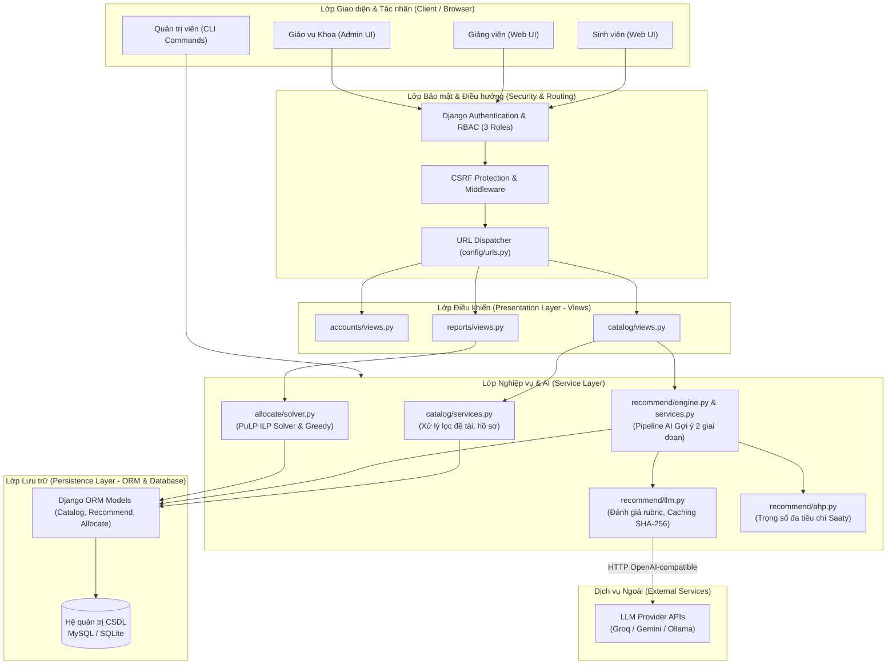
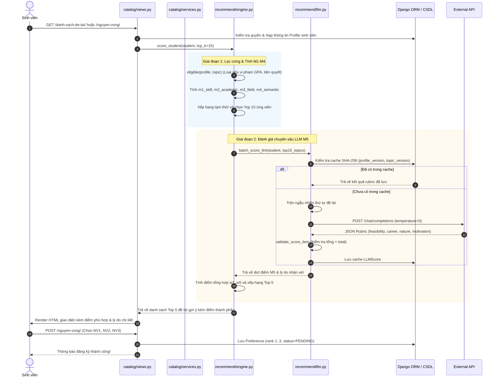

# Giải thích Kiến trúc Hệ thống Capstone Advisor AI

> **Dành cho:** Anh Trịnh Hoàng Thành (vibe code thực chiến, chuẩn bị bảo vệ đồ án tốt nghiệp)  
> **Người hướng dẫn:** ThS. Đặng Khánh Trung (Kỹ sư Java Enterprise, kiến trúc phân tầng chặt chẽ, tư duy OpenCPS)  
> **Mục tiêu:** Hiểu sâu bản chất kiến trúc, giải thích tự tin, bảo vệ xuất sắc trước hội đồng.

---

## 1. Ví dụ đời thường: Bếp ăn nhà hàng 5 sao

Hãy tưởng tượng hệ thống **Capstone Advisor AI** giống như quy trình vận hành của một **nhà hàng ẩm thực cao cấp**:

```
[ Khách hàng ] ── gọi món ──► [ Nhân viên tiếp tân / Bồi bàn ]
                                       │
                                chuyển phiếu order
                                       ▼
                              [ Bếp trưởng & Phụ bếp ] ◄── lấy nguyên liệu ──► [ Kho bảo quản ]
                                 (Chế biến, nêm nếm)                              (Tủ đông, kệ gia vị)
```

1. **Khách hàng (User: Sinh viên, Giảng viên, Giáo vụ Khoa):** Người gửi yêu cầu (muốn xem gợi ý đề tài, muốn đăng ký nguyện vọng, muốn chạy phân công).
2. **Bồi bàn tiếp tân (Tầng View / Controller):**
   - Nhiệm vụ duy nhất: Chào khách, kiểm tra thẻ khách (xác thực `auth` & phân quyền vai trò), nhận phiếu yêu cầu và chuyển nhanh xuống khu bếp.
   - **Tuyệt đối không bao giờ:** Bồi bàn tự tiện đứng xào nấu ngay tại bàn ăn (nghĩa là View không được chứa logic toán học hay thuật toán AI phức tạp).
3. **Bếp trưởng tài ba (Tầng Service / Business Logic):**
   - Nơi tập trung toàn bộ kỹ thuật tinh hoa: Bếp trưởng lấy công thức bí truyền (M1–M5, AHP, thuật toán tối ưu ILP), sơ chế, xào nấu và tạo ra món ăn hoàn hảo.
   - Trong code: Đây là các file `services.py`, `engine.py`, `solver.py`.
4. **Kho nguyên liệu bảo quản (Tầng Model / CSDL):**
   - Nơi cất giữ thịt cá, rau củ có dán nhãn phân loại rõ ràng (Bảng CSDL MySQL / SQLite).
   - Thủ kho quản lý xuất/nhập nguyên liệu theo quy chuẩn an toàn thực phẩm (Django ORM, Transactions).

👉 **Bài học kiến trúc rút ra:** Nếu bồi bàn vừa bưng bê vừa vào bếp nêm gia vị, nhà hàng sẽ hỗn loạn ngay khi đông khách. Việc tách bạch rành mạch giữa **Giao diện (View)**, **Nghiệp vụ (Service)** và **Lưu trữ (Model)** giúp hệ thống hoạt động bền bỉ, dễ bảo trì, dễ viết kiểm thử tự động.

---

## 2. Ánh xạ kiến trúc: So sánh Django MVT với Spring Boot MVC của dân Java

Vì Thầy hướng dẫn là chuyên gia Java nhiều năm kinh nghiệm, Thầy rất chú trọng tư duy phân tầng chuẩn mực của các hệ thống Enterprise (như Spring Boot, Java EE, OpenCPS). Dưới đây là bảng ánh xạ tương đương:

| Khái niệm trong Spring Boot (Java) | Vị trí tương đương trong Capstone Advisor AI (Django) | Vai trò & Trách nhiệm chính |
|---|---|---|
| **Controller (`@RestController`, `@Controller`)** | `views.py` (`catalog/views.py`, `accounts/views.py`) | Nhận HTTP Request, trích xuất tham số, kiểm tra quyền (`@login_required`), gọi Service, trả về HTTP Response hoặc render HTML template. |
| **Service Layer (`@Service`)** | `services.py`, `engine.py`, `solver.py` | Trái tim nghiệp vụ: Tính toán điểm gợi ý AI M1–M5, giải bài toán phân công ILP PuLP, xử lý nghiệp vụ phức tạp. Tuyệt đối không dính mã HTML. |
| **DAO / Repository (`@Repository`, Spring Data JPA)** | `models.py` + Django ORM Manager | Định nghĩa bảng dữ liệu (`models.Model`), các mối quan hệ (1-n, n-n), ràng buộc toàn vẹn, truy vấn CSDL (`select_related`, `prefetch_related`). |
| **Entity (`@Entity`)** | Django Model Instances (`Student`, `Topic`, `Preference`) | Các đối tượng dữ liệu phản ánh một hàng (record) trong bảng CSDL. |
| **View Template (Thymeleaf / JSP)** | Django Templates (`templates/**/*.html`) | Chỉ nhận dữ liệu `context` từ View để hiển thị cho người dùng, sử dụng cú pháp `{{ }}` và ``. Tuyệt đối không viết truy vấn CSDL nặng trong template. |
| **Spring Security** | `django.contrib.auth` + Custom User Role | Xác thực người dùng, bảo vệ CSRF token, phân quyền theo 3 vai trò (`Role.STUDENT`, `Role.LECTURER`, `Role.ADMIN`). |
| **Scheduled Tasks / CommandLineRunner** | Django Management Commands (`management/commands/*.py`) | Chạy các tác vụ dòng lệnh định kỳ hoặc mô phỏng: `seed_demo`, `allocate_period`, `ahp_weights`. |

---

## 3. Bản đồ cấu trúc Codebase & Chỉ rõ File/Hàm

Dự án tuân thủ nghiêm ngặt nguyên tắc **Modular Monolith** — chia nhỏ hệ thống thành các ứng dụng (Django apps) độc lập, mỗi app quản lý một miền nghiệp vụ riêng biệt:

```
capstone-advisor/
├── accounts/          # Quản lý tài khoản, vai trò, xác thực người dùng
├── catalog/           # Dữ liệu cốt lõi: Sinh viên, Giảng viên, Đề tài, Đợt đăng ký, Nguyện vọng
├── recommend/         # LÕI AI GỢI Ý: Mô hình kết hợp M1–M5, AHP, gọi LLM API
├── allocate/          # LÕI PHÂN CÔNG: Tối ưu hoá quy hoạch tuyến tính nguyên (ILP) & Tham lam
├── reports/           # Thống kê, báo cáo KPI cho Giáo vụ Khoa
├── templates/         # Giao diện người dùng (Bootstrap 5)
└── config/            # Cấu hình dự án Django (settings, urls, wsgi/asgi)
```

### 3.1. Phân hệ Tài khoản (`accounts/`)
- [accounts/models.py](../../accounts/models.py): Khai báo model `User` kế thừa `AbstractUser`, bổ sung enum `User.Role`:
  ```python
  class Role(models.TextChoices):
      STUDENT = "STUDENT", "Sinh viên"
      LECTURER = "LECTURER", "Giảng viên"
      ADMIN = "ADMIN", "Khoa"
  ```
  Cung cấp các properties kiểm tra quyền nhanh: `is_student`, `is_lecturer`, `is_faculty_admin`.
- [accounts/views.py](../../accounts/views.py):
  - Hàm `home(request)`: Điều hướng người dùng về đúng trang chủ chuyên biệt theo vai trò (`home_student.html`, `home_lecturer.html`, `home_admin.html`).

### 3.2. Phân hệ Dữ liệu Nghiệp vụ (`catalog/`)
- [catalog/models.py](../../catalog/models.py):
  - `Student`: Hồ sơ sinh viên, liên kết 1-1 với `User`, GPA, giới thiệu bản thân (`about`).
  - `Lecturer`: Thông tin giảng viên, học hàm, học vị, chỉ tiêu hướng dẫn tối đa (`max_students`).
  - `Topic`: Đề tài tốt nghiệp, sức chứa (`capacity`), điểm GPA tối thiểu (`min_gpa`), phiên bản (`version`).
  - `Skill`, `TopicSkill`, `StudentSkill`: Bảng kỹ năng và ma trận đo mức độ thành thạo (thang 1–5).
  - `RegistrationPeriod`: Đợt đăng ký đồ án, thời gian bắt đầu, kết thúc, trạng thái (`DRAFT`, `OPEN`, `CLOSED`, `PUBLISHED`).
  - `Preference`: Nguyện vọng đăng ký của sinh viên (xếp hạng 1, 2, 3), trạng thái duyệt (`PENDING`, `ACCEPTED`, `REJECTED`).
- [catalog/services.py](../../catalog/services.py):
  - Hàm `filter_topics(...)`: Xử lý lọc danh sách đề tài theo từ khóa, lĩnh vực, giảng viên và phân trang.
  - Các hàm `get_topic_nv1_count(...)`, `get_student_match_score(...)`: Tập hợp dữ liệu chi tiết đề tài, số lượng đăng ký NV1 và điểm gợi ý phù hợp cho sinh viên đang đăng nhập.
- [catalog/views.py](../../catalog/views.py):
  - Hàm `student_profile(...)`: Xem và cập nhật kỹ năng, lĩnh vực quan tâm và giới thiệu bản thân.
  - Hàm `student_preferences(...)`: Đăng ký nguyện vọng NV1–NV3 cho đợt đang mở.
  - Hàm `lecturer_topics(...)` & `lecturer_registrations(...)`: Giảng viên quản lý đề tài và duyệt sinh viên đăng ký.

### 3.3. Phân hệ AI Gợi ý Đề tài (`recommend/`)
- [recommend/engine.py](../../recommend/engine.py):
  - `eligible(p, topic)`: Lọc cứng điều kiện biên (GPA sàn, môn tiên quyết, kỹ năng bắt buộc).
  - `m1_skill(...)`, `m2_academic(...)`, `m3_field(...)`: Tính điểm M1 (Kỹ năng), M2 (Học lực), M3 (Lĩnh vực).
  - `SemanticModel` & `m4_semantic(...)`: Mô hình embedding `MiniLM-L12-v2` tính độ gần nghĩa ngữ nghĩa.
  - `score_student(...)`: Pipeline tổng hợp 2 giai đoạn (Giai đoạn 1 lọc cứng + M1–M4 chọn Top-15; Giai đoạn 2 gọi LLM chấm M5 theo rubric).
  - `explain(candidate)`: Tạo lời giải thích đa tầng minh bạch cho người dùng.
- [recommend/llm.py](../../recommend/llm.py):
  - `batch_score_llm(...)`: Gọi API LLM (Groq / Gemini / Ollama) chấm điểm M5 theo rubric 100 điểm, có trộn ngẫu nhiên thứ tự chống thiên lệch vị trí (position bias) và cơ chế cache SHA-256.
  - `score_pair(...)`: Chấm bù M5 khi sinh viên chọn nguyện vọng ngoài Top-K.
- [recommend/ahp.py](../../recommend/ahp.py):
  - `calculate_ahp(...)`: Tính vector trọng số $w$ và tỷ số nhất quán $CR$ từ ma trận so sánh cặp $5 \times 5$.

### 3.4. Phân hệ Phân công Tối ưu (`allocate/`)
- [allocate/solver.py](../../allocate/solver.py):
  - `compute_utility(...)`: Tính điểm thỏa dụng $U(s, t)$ kết hợp điểm AI, ưu tiên nguyện vọng và GPA.
  - `solve_ilp(...)`: Thiết lập mô hình bài toán Quy hoạch nguyên tuyến tính và giải bằng CBC Solver của thư viện PuLP.
  - `solve_greedy(...)`: Thuật toán tham lam (Greedy Baseline) dùng để đối sánh thực nghiệm.
  - `metrics(...)`: Đánh giá 7 chỉ số chất lượng phân công.
  - `suggest_remaining_topics(...)`: Pha 2 gợi ý đề tài còn chỗ cho các sinh viên chưa được xếp.
- [allocate/management/commands/allocate_period.py](../../allocate/management/commands/allocate_period.py):
  - Lệnh CLI thực hiện phân công tự động toàn diện cho một đợt đăng ký và lưu bảng nháp `Allocation (DRAFT)`.

---

## 4. Các nguyên lý thiết kế và Chuẩn Code sạch (Clean Code)

Dự án được xây dựng dựa trên các chuẩn mực khắt khe của công nghiệp phần mềm:

### 4.1. Nguyên lý phân tách trách nhiệm (Separation of Concerns - SoC)
- **Thin Views - Rich Services:** Views chỉ đóng vai trò giao tiếp (Controller), không nhồi nhét thuật toán. Mọi tính toán AI hay giải phương trình phân công đều đóng gói trong `recommend/` và `allocate/`.
- **Declarative Models:** Models chỉ định nghĩa cấu trúc dữ liệu, quan hệ khóa ngoại, validation cơ bản và phương thức hiển thị `__str__`.

### 4.2. Giới hạn độ phức tạp hàm (McCabe Cyclomatic Complexity $\le 10$)
- Được kiểm tra tự động bằng `ruff check .` với luật `C901`.
- Mọi hàm có logic rẽ nhánh phức tạp đều được phân tách thành các hàm trợ giúp (helper functions) nhỏ gọn, đơn nhiệm, giúp code dễ đọc và dễ unit test độc lập.

### 4.3. Quản lý truy vấn hiệu quả, chống vấn nạn N+1 (N+1 Query Problem)
- Khi hiển thị danh sách 50 đề tài kèm thông tin giảng viên và kỹ năng yêu cầu:
  - **Cách làm dở (N+1 queries):** Vòng lặp duyệt từng đề tài rồi truy vấn bảng giảng viên $\to$ tốn 51 truy vấn vào CSDL.
  - **Cách làm chuẩn trong dự án:**
    ```python
    topics = Topic.objects.select_related("lecturer").prefetch_related(
        "skills__skill", "prerequisites__course", "fields"
    )
    ```
    Toàn bộ dữ liệu được nạp chỉ trong 4 câu truy vấn SQL tối ưu hóa cao.

### 4.4. Đảm bảo toàn vẹn dữ liệu bằng Transaction (`transaction.atomic`)
- Khi lưu kết quả phân công cho 100 sinh viên, toàn bộ thao tác xóa bản nháp cũ và chèn hàng loạt bản ghi mới được bọc trong khối transaction nguyên tố:
  ```python
  with transaction.atomic():
      Allocation.objects.filter(period=period, status=Allocation.Status.DRAFT).delete()
      Allocation.objects.bulk_create(allocations)
  ```
  Nếu có bất kỳ sự cố nào xảy ra giữa chừng, CSDL sẽ tự động rollback về trạng thái an toàn, không bao giờ để lại dữ liệu rác hoặc dữ liệu mồ côi.

---

## 5. Sơ đồ Kiến trúc & Luồng xử lý (Mermaid)

### 5.1. Sơ đồ Kiến trúc phân tầng tổng thể (Layered Architecture)



### 5.2. Sơ đồ Tuần tự (Sequence Diagram): Luồng Sinh viên xem gợi ý và đăng ký nguyện vọng


