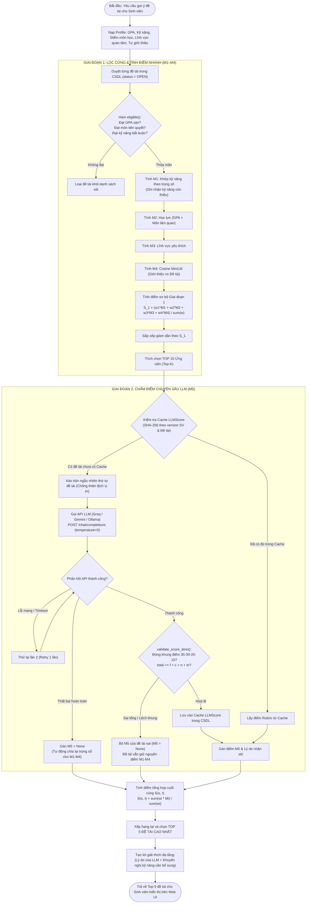

# Giải thích Mô hình Gợi ý Đề tài Hai Giai đoạn (M1–M5 Ensemble)

> **Dành cho:** Anh Trịnh Hoàng Thành (vibe code thực chiến, chuẩn bị bảo vệ đồ án tốt nghiệp)  
> **Mục tiêu:** Nắm chắc bản chất 2 giai đoạn gợi ý, thuộc làu công thức M1–M5, hiểu rõ cơ chế chống thiên lệch và fallback của LLM.

---

## 1. Ví dụ đời thường: Quy trình tuyển dụng nhân tài 2 vòng

Hãy tưởng tượng một công ty công nghệ lớn tuyển dụng thực tập sinh đồ án. Có **50 đề tài** đang mở và **hàng trăm sinh viên** ứng tuyển:

```
[ Toàn bộ 50 đề tài ]
         │
         ▼
[ VÒNG 1: Sơ tuyển hồ sơ & Đánh giá tự động ] ── Lọc cứng (GPA, Tiên quyết, Kỹ năng bắt buộc)
         │                                   └── Chấm điểm nhanh qua 4 tiêu chí (M1, M2, M3, M4)
         ▼
[ TOP 15 Ứng viên sáng giá nhất ]
         │
         ▼
[ VÒNG 2: Phỏng vấn chuyên sâu bởi Chuyên gia (LLM) ] ── Chấm theo Rubric 100 điểm (M5)
         │                                            └── Đánh giá động lực, kinh nghiệm, định hướng
         ▼
[ TOP 5 Đề tài phù hợp nhất ] ── Kèm bảng điểm chi tiết & Lời giải thích minh bạch
```

1. **Vòng 1 (Lọc cứng & Chấm máy nhanh - M1 đến M4):**
   - **Lọc cứng (BR1):** Giống như phòng nhân sự quét CV tự động. Đề tài yêu cầu GPA $\ge 2.5$, bạn chỉ được 2.4 $\to$ loại ngay. Đề tài bắt buộc phải qua môn *Mạng máy tính*, bạn chưa học $\to$ loại ngay.
   - **Chấm máy tự động (M1–M4):** Rất nhanh, chi phí tính toán cực thấp (chỉ mất vài mili-giây):
     - **M1 (Kỹ năng):** Đề tài cần Python mức 4, bạn có mức 3 $\to$ đạt 75%.
     - **M2 (Học lực):** Xem điểm GPA tổng và điểm các môn chuyên ngành liên quan.
     - **M3 (Lĩnh vực):** Bạn đánh dấu thích mảng "Trí tuệ nhân tạo" $\to$ đề tài AI được cộng điểm.
     - **M4 (Ngữ nghĩa):** Đọc phần "Giới thiệu bản thân" của bạn và so với "Mô tả đề tài" xem cách dùng từ và ý tưởng có tương đồng không (dùng AI nhúng vector MiniLM).
   - Chọn ra **Top 15 đề tài** có điểm số cao nhất để vào Vòng 2.

2. **Vòng 2 (Phỏng vấn chuyên sâu - M5 bằng LLM):**
   - Tại sao không đưa thẳng cả 50 đề tài cho LLM chấm ngay từ đầu? Vì đưa 50 đề tài vào prompt sẽ làm context quá dài, chi phí API tốn kém, thời gian phản hồi rất chậm (lag), và LLM dễ bị "lú" (ảo giác/hallucination).
   - Do đó, chỉ gửi **Top 15 đề tài** đã qua sơ tuyển cho LLM. LLM đóng vai trò như một **Hội đồng chuyên gia phỏng vấn**, chấm điểm khắt khe theo một bảng Rubric 100 điểm chuẩn hóa.
   - Kết hợp điểm số của cả hai vòng để chọn ra **Top 5 đề tài xuất sắc nhất** hiển thị cho sinh viên.

---

## 2. Bản đồ File & Hàm trong Codebase

| Chức năng | Vị trí File / Hàm | Trách nhiệm thực thi |
|---|---|---|
| **Lọc cứng điều kiện (BR1)** | `eligible(p, topic)` trong [recommend/engine.py](../../recommend/engine.py) | Kiểm tra GPA sàn, môn tiên quyết, kỹ năng bắt buộc. Trả về `(True/False, lý do)`. |
| **M1: Khớp kỹ năng** | `m1_skill(p, topic)` trong [recommend/engine.py](../../recommend/engine.py) | Tính % đáp ứng kỹ năng có trọng số. Trả về điểm 0–100 và danh sách kỹ năng còn thiếu. |
| **M2: Khớp học lực** | `m2_academic(p, topic)` trong [recommend/engine.py](../../recommend/engine.py) | Kết hợp GPA chung và điểm trung bình các môn liên quan trực tiếp đến đề tài. Thang cố định 0–100. |
| **M3: Khớp lĩnh vực** | `m3_field(p, topic)` trong [recommend/engine.py](../../recommend/engine.py) | Đo mức độ sinh viên quan tâm đến các lĩnh vực của đề tài (thang 1–3). Trả về điểm 0–100. |
| **M4: Độ gần nghĩa** | `SemanticModel` & `m4_semantic(...)` trong [recommend/engine.py](../../recommend/engine.py) | Dùng mô hình `paraphrase-multilingual-MiniLM-L12-v2` nhúng văn bản thành vector 384 chiều, tính Cosine Similarity. |
| **M5: Chấm Rubric LLM** | `batch_score_llm(...)` trong [recommend/llm.py](../../recommend/llm.py) | Gộp 1 lần gọi cho Top 15 đề tài, trộn thứ tự ngẫu nhiên, kiểm tra tính toàn vẹn rubric, lưu cache SHA-256. |
| **Chấm bù M5 đơn lẻ** | `score_pair(student, topic)` trong [recommend/llm.py](../../recommend/llm.py) | Tính bù điểm M5 khi sinh viên chọn nguyện vọng một đề tài nằm ngoài Top 15. |
| **Điều phối 2 giai đoạn** | `score_student(...)` trong [recommend/engine.py](../../recommend/engine.py) | Nhận sinh viên, chạy Giai đoạn 1 $\to$ Giai đoạn 2 $\to$ Trả về danh sách ứng viên có điểm cuối và lời giải thích. |
| **Giải thích minh bạch** | `explain(candidate)` trong [recommend/engine.py](../../recommend/engine.py) | Ghép lý do định tính của LLM với danh sách kỹ năng cần bổ sung từ M1. |

---

## 3. Công thức Toán học chi tiết từng thành phần (M1 – M5)

### 3.1. Lọc cứng điều kiện tiên quyết (Hard Filtering - BR1)
Sinh viên $s$ chỉ được xét đề tài $t$ nếu thỏa mãn đồng thời 3 điều kiện:
1. $\text{GPA}_s \ge \text{min\_gpa}_t$
2. $\forall c \in \text{Prerequisites}_t: \text{score}(s, c) \ge \text{min\_score}(c)$
3. $\forall k \in \text{MandatorySkills}_t: \text{level}(s, k) \ge \text{req\_level}(t, k)$

Nếu không đạt bất kỳ điều kiện nào, đề tài bị loại ngay lập tức và gắn kèm lý do vi phạm (ví dụ: *"GPA 2.4 thấp hơn yêu cầu 2.5"*).

---

### 3.2. M1 — Mức độ phù hợp kỹ năng (Skill Match Score)
Đo lường mức độ sinh viên đáp ứng các kỹ năng mà đề tài yêu cầu, có tính đến trọng số ưu tiên của từng kỹ năng:

$$\mathbf{M_1(s, t) = 100 \times \frac{\sum_{k \in K_t} w_k \cdot \min\left( \frac{\text{level}_{s, k}}{\text{req}_{t, k}}, \, 1.0 \right)}{\sum_{k \in K_t} w_k}}$$

- $K_t$: Tập hợp các kỹ năng đề tài $t$ yêu cầu.
- $w_k$: Trọng số quan trọng của kỹ năng $k$ do giảng viên thiết lập (mặc định $1.0$).
- $\text{level}_{s, k}$: Mức độ thành thạo của sinh viên ở kỹ năng $k$ (thang 1–5).
- $\text{req}_{t, k}$: Mức độ thành thạo đề tài đòi hỏi (thang 1–5).
- Hàm $\min(\cdot, 1.0)$ giúp tránh việc sinh viên quá giỏi ở 1 kỹ năng bù trừ khống cho các kỹ năng khác còn thiếu.
- *Ghi chú:* Nếu đề tài không yêu cầu kỹ năng nào cụ thể, $M_1 = 100.0$.

---

### 3.3. M2 — Năng lực học tập & Môn liên quan (Academic Competence)
Đánh giá học lực toàn diện, không chỉ nhìn vào GPA chung mà chú trọng đặc biệt vào điểm số các môn nền tảng của đề tài:

$$\mathbf{M_2(s, t) = 100 \times \left( 0.4 \times \frac{\text{GPA}_s}{4.0} + 0.6 \times \frac{\overline{\text{Score}}_{\text{related}}}{10.0} \right)}$$

- $\text{GPA}_s$: Điểm trung bình tích lũy hệ 4 của sinh viên.
- $\overline{\text{Score}}_{\text{related}}$: Điểm trung bình thang 10 của các môn học liên quan. Môn liên quan bao gồm:
  $$\text{RelatedCourses} = \text{Prerequisites}_t \cup \{ c \in \text{Courses}_s \mid \text{field}(c) \in \text{fields}(t) \}$$
- Nếu sinh viên chưa có môn nào liên quan trong học bạ: Hệ thống quy đổi ước lượng từ GPA: $\overline{\text{Score}}_{\text{related}} = \text{GPA}_s \times 2.5$.
- *Điểm nhấn kiến trúc:* Sử dụng thang điểm quy chuẩn cố định (thang 4 và thang 10), **không chuẩn hóa Min-Max theo tập dữ liệu hiện tại**, đảm bảo điểm số của một sinh viên là bất biến, không bị nhảy điểm khi có thêm sinh viên khác nhập học.

---

### 3.4. M3 — Mức độ phù hợp lĩnh vực quan tâm (Field Interest Match)
Đo lường sự hứng thú của sinh viên đối với các chuyên ngành mà đề tài trực thuộc:

$$\mathbf{M_3(s, t) = 100 \times \frac{1}{|F_t|} \sum_{f \in F_t} \frac{\text{interest}_{s, f}}{3.0}}$$

- $F_t$: Tập các lĩnh vực của đề tài $t$ (ví dụ: `["Trí tuệ nhân tạo", "Dữ liệu"]`).
- $\text{interest}_{s, f}$: Mức độ quan tâm của sinh viên đối với lĩnh vực $f$ (thang 1–3: 1 - Quan tâm, 2 - Yêu thích, 3 - Ưu tiên hàng đầu; nếu không điền thì mặc định $0$).
- *Điểm cải tiến quan trọng:* Phiên bản cũ dùng độ tương đồng Jaccard đã bị loại bỏ vì sinh viên quan tâm rộng nhiều lĩnh vực sẽ bị phạt điểm oan (mẫu số tập hợp lớn). Công thức trung bình trên tập lĩnh vực của đề tài đảm bảo nếu đề tài thuộc lĩnh vực bạn đam mê nhất, điểm $M_3$ luôn đạt tối đa 100 điểm.

---

### 3.5. M4 — Độ gần nghĩa ngữ nghĩa văn bản (Semantic Text Embedding)
So khớp mức độ tương đồng giữa nội dung tự giới thiệu / định hướng của sinh viên với tiêu đề và mô tả đề tài:

$$\vec{e}_s = \text{Normalize}(\text{MiniLM}(\text{student.about})) \in \mathbb{R}^{384}$$
$$\vec{e}_t = \text{Normalize}(\text{MiniLM}(\text{topic.title} + \text{". "} + \text{topic.description})) \in \mathbb{R}^{384}$$
$$\mathbf{M_4(s, t) = 100 \times \max\left( 0.0, \, \vec{e}_s \cdot \vec{e}_t \right)}$$

- Sử dụng mô hình nguồn mở đa ngôn ngữ `sentence-transformers/paraphrase-multilingual-MiniLM-L12-v2` (kích thước nhỏ gọn ~470 MB, chạy mượt mà trên CPU thông thường).
- Vì các vector nhúng đã được chuẩn hóa độ dài đơn vị ($\|\vec{e}\| = 1$), Cosine Similarity chính là tích vô hướng $\vec{e}_s \cdot \vec{e}_t$.
- **Cơ chế Cache tối ưu:** Vector của đề tài được lưu trong bộ nhớ theo cặp khóa `(topic.id, topic.version)`. Chỉ khi giảng viên cập nhật nội dung đề tài (tăng `version`), hệ thống mới tính toán lại vector, giúp tốc độ phản hồi cực nhanh.

---

### 3.6. M5 — Đánh giá chuyên sâu LLM theo Rubric 100 điểm

LLM không được chấm cảm tính hay chung chung, mà phải chấm điểm theo đúng **Rubric 4 tiêu chí khắt khe**:

| Tiêu chí Rubric | Thang điểm | Nội dung đánh giá |
|---|:---:|---|
| **1. Khả thi (`feasibility`)** | **0 – 35 điểm** | Đánh giá mức độ khả thi dựa trên kinh nghiệm tự kể, các dự án thực tế đã làm của sinh viên trong phần tự giới thiệu. |
| **2. Định hướng nghề (`career`)** | **0 – 30 điểm** | Đề tài có gắn liền với mục tiêu nghề nghiệp tương lai mà sinh viên hướng tới (ví dụ: làm AI Engineer, Web Fullstack, DevOps) hay không. |
| **3. Tính chất đề tài (`nature`)** | **0 – 20 điểm** | Độ phù hợp về tính chất đề tài (nghiên cứu lý thuyết hàn lâm hay phát triển ứng dụng thực chiến) với thế mạnh của sinh viên. |
| **4. Động lực thể hiện (`motivation`)** | **0 – 15 điểm** | Mức độ nhiệt huyết, khát khao nghiên cứu và thái độ chủ động thể hiện qua câu từ tự giới thiệu. |

$$\mathbf{M_5(s, t) = \text{feasibility} + \text{career} + \text{nature} + \text{motivation}} \quad (0 \le M_5 \le 100)$$

**3 Nguyên tắc thiết kế LLM tối thượng trong dự án:**
1. **Không chấm lại Kỹ năng & GPA:** Prompt hệ thống cấm tuyệt đối LLM chấm lại kỹ năng và GPA vì hệ thống đã tính chính xác ở $M_1, M_2$. LLM chỉ tập trung khai phá ngữ nghĩa sâu và kinh nghiệm tự kể.
2. **Chống thiên lệch vị trí (Position Bias Mitigation):** Các mô hình ngôn ngữ thường có xu hướng ưu ái chấm điểm cao hơn cho các đề tài xuất hiện đầu tiên trong danh sách. Hệ thống khắc phục triệt để bằng cách `random.shuffle` danh sách đề tài trước khi gửi vào prompt, sau đó dùng `topic_id` để map điểm trả về chính xác.
3. **Kiểm tra tính hợp lệ & Fallback an toàn (Graceful Degradation):**
   - Hàm `validate_score_item(item)` kiểm tra: từng tiêu chí có nằm trong khung điểm không và $\text{total} == f + c + n + m$.
   - Nếu tổng sai hoặc LLM lỗi JSON/mạng sau 1 lần thử lại: Đề tài **KHÔNG** bị loại khỏi danh sách gợi ý. Hệ thống chỉ đặt $M_5 = \text{None}$, và công thức tổng hợp sẽ tự động tái phân bổ trọng số cho 4 mô hình $M_1–M_4$ còn lại!

---

### 3.7. Điểm Tổng hợp Cuối cùng (Ensemble Final Score)

Điểm phù hợp tổng hợp giữa sinh viên $s$ và đề tài $t$ là trung bình có trọng số của các thành phần hợp lệ:

$$\mathbf{S(s, t) = \frac{\sum_{i \in \text{ValidComponents}} w_i \cdot M_i(s, t)}{\sum_{i \in \text{ValidComponents}} w_i}}$$

- Bộ trọng số chuẩn: $w = (w_1, w_2, w_3, w_4, w_5) = (0.25, 0.20, 0.15, 0.20, 0.20)$ (tổng bằng $1.0$).
- Nếu một thành phần $M_i$ chưa có hoặc bị lỗi (ví dụ không bật M4, hoặc LLM bị lỗi mạng $\to M_5 = \text{None}$), mẫu số sẽ tự động co lại bằng tổng các trọng số còn lại. Điểm số luôn chuẩn hóa về thang $0–100$.

---

## 4. Sơ đồ Luồng Pipeline Gợi ý Đề tài (Mermaid)


