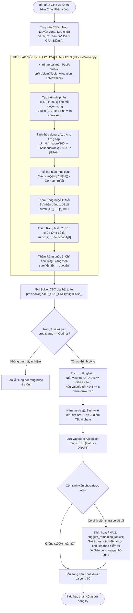

# Giải thích Thuật toán Phân công Tối ưu ILP (Integer Linear Programming)

> **Dành cho:** Anh Trịnh Hoàng Thành (vibe code thực chiến, chuẩn bị bảo vệ đồ án tốt nghiệp)  
> **Mục tiêu:** Nắm chắc bản chất bài toán tối ưu phân công, hiểu sâu vì sao ILP đè bẹp Greedy, thuộc công thức hàm mục tiêu, hàm thỏa dụng, 3 ràng buộc cứng và ý nghĩa của trọng số phạt $\lambda$.

---

## 1. Ví dụ đời thường: Xếp chỗ ngồi trên xe buýt du lịch

Hãy tưởng tượng một chuyến xe du lịch chở **100 hành khách (Sinh viên)**. Trên xe có **30 hàng ghế (Đề tài)**:
- Mỗi hàng ghế chỉ ngồi được tối đa **2–3 người (Sức chứa - `capacity`)**.
- Các hàng ghế thuộc quyền quản lý của **10 hướng dẫn viên (Giảng viên hướng dẫn)**, mỗi hướng dẫn viên chỉ được chăm sóc tối đa **10 người (Chỉ tiêu - `quota`)**.
- Mỗi hành khách được đăng ký **3 nguyện vọng chỗ ngồi yêu thích** (NV1: gần cửa sổ ngắm cảnh, NV2: gần lối đi thoáng mát, NV3: gần bạn bè).

```
                      [ BÀI TOÁN XẾP CHỖ TRANH CHẤP GAY GẮT ]
           Nhiều người cùng tranh nhau hàng ghế số 1 (Đề tài "hot")!
                                       │
                    Hai cách tiếp cận giải quyết bài toán:
                                       │
     ┌─────────────────────────────────┴─────────────────────────────────┐
     ▼                                                                   ▼
[ CÁCH 1: THAM LAM (GREEDY) ]                       [ CÁCH 2: QUY HOẠCH NGUYÊN (ILP) ]
"Ai đến trước / Điểm cao lấy trước"                 "Nhìn toàn cục như một vị Tổng tư lệnh"
- Người top đầu ôm hết chỗ tốt.                     - Cân đối phân bổ hài hòa toàn bộ 100 người.
- Người phía sau bị đẩy văng ra ghế xấu             - Tối đa hóa tổng mức độ thỏa mãn toàn trường.
  hoặc không có chỗ ngồi (văng khỏi xe).            - Không một ai vi phạm chỉ tiêu hay sức chứa.
- TỔNG HÀI LÒNG CẢ XE: RẤT THẤP!                     - TỔNG HÀI LÒNG CẢ XE: TỐI ƯU TOÀN CỤC!
```

- **Nếu dùng thuật toán Tham lam (Greedy / Xét lần lượt theo GPA):**
  - Sinh viên giỏi nhất chọn NV1 $\to$ giữ chỗ ngay. Sinh viên giỏi nhì chọn NV1 $\to$ hết chỗ đề tài hot.
  - Sinh viên thứ 50 chỉ kém chút xíu nhưng vì đề tài hot đã hết chỗ, họ bị trôi xuống NV2, NV3 (thậm chí các đề tài NV2, NV3 đó cũng bị người khác lấy mất). Kết quả: Hàng loạt sinh viên bị bỏ rơi không có đề tài, trong khi nhiều đề tài khác lại ế ẩm.
- **Nếu dùng Quy hoạch nguyên tuyến tính (ILP - PuLP CBC):**
  - Thuật toán không xét lần lượt từng người một cách cục bộ. Nó đặt toàn bộ 100 sinh viên, 300 nguyện vọng và tất cả các ràng buộc lên một bàn cờ lớn.
  - ILP tìm một phương án ghép cặp tối ưu toán học sao cho **tổng độ thỏa dụng của toàn bộ sinh viên đạt giá trị lớn nhất có thể**, đồng thời đảm bảo không có bất kỳ đề tài nào bị quá tải hay giảng viên nào bị vượt chỉ tiêu.

---

## 2. Vì sao đồ án chọn ILP (PuLP) thay vì thuật toán khác?

Hội đồng bảo vệ rất hay đặt câu hỏi: *"Tại sao em không dùng Gale-Shapley (Stable Marriage), Thuật toán Hungari (Munkres) hay Giải thuật Di truyền (Genetic Algorithm)?"*

Bảng so sánh bản chất kỹ thuật để anh Thành tự tin trả lời:

| Thuật toán | Ưu điểm | Nhược điểm chí mạng trong bài toán này | Có chọn không? |
|---|---|---|:---:|
| **Greedy (Tham lam)** | Code đơn giản, chạy siêu nhanh (dưới 0.01s). | Cực trị cục bộ (Local Optima), tỷ lệ sinh viên có đề tài thấp, dễ tạo bất công xã hội. | ❌ (Chỉ dùng làm Baseline đối sánh) |
| **Gale-Shapley (Ghép cặp ổn định)** | Đảm bảo tính ổn định (không có cặp nào muốn 'bỏ nhau'). | Yêu cầu Giảng viên phải chấm điểm xếp hạng toàn bộ sinh viên đăng ký; khó xử lý chỉ tiêu kép (vừa sức chứa đề tài vừa chỉ tiêu GV). | ❌ Không phù hợp thực tế |
| **Thuật toán Hungari (Munkres)** | Tối ưu ghép cặp trên đồ thị hai phía ($O(V^3)$). | Chỉ áp dụng được cho bài toán gán 1-1 (1 người - 1 việc). Khi mở rộng ra 1 đề tài nhận nhiều SV thì phải nhân bản node rất cồng kềnh. | ❌ Quá cứng nhắc |
| **Genetic Algorithm (Di truyền)** | Giải được bài toán phi tuyến phức tạp. | Nghiệm xấp xỉ không chắc chắn là nghiệm tối ưu tuyệt đối; thời gian chạy lâu, khó kiểm soát ràng buộc cứng. | ❌ Không đảm bảo nghiệm chuẩn |
| **ILP (PuLP + CBC Solver)** | **Nghiệm tối ưu toàn cục (Global Optimum)**; biểu diễn tự nhiên mọi ràng buộc tuyến tính đa tầng; solver CBC cực mạnh giải 1.000 SV trong chưa đầy 1 giây! | Phải mô hình hóa bài toán thành hệ phương trình tuyến tính nguyên chuẩn tắc. | ✅ **SỰ LỰA CHỌN TỐI ƯU NHẤT** |

---

## 3. Bản đồ File & Hàm trong Codebase

Toàn bộ logic tối ưu phân công được đóng gói tại ứng dụng [allocate/](../../allocate/):

| Vị trí File / Hàm | Trách nhiệm thực thi |
|---|---|
| `compute_utility(...)` trong [allocate/solver.py](../../allocate/solver.py) | Hàm tính điểm thỏa dụng $U(s, t)$ khi gán sinh viên $s$ vào đề tài $t$. Kết hợp điểm AI, điểm thưởng thứ tự NV và GPA để phân giải hòa điểm. |
| `_build_ilp_constraints(...)` trong [allocate/solver.py](../../allocate/solver.py) | Thiết lập 3 hệ phương trình ràng buộc cứng tuyến tính (ràng buộc gán duy nhất, sức chứa đề tài, chỉ tiêu giảng viên). |
| `solve_ilp(...)` trong [allocate/solver.py](../../allocate/solver.py) | Xây dựng mô hình PuLP `LpProblem(..., LpMaximize)` với solver `PULP_CBC_CMD`, giải tìm biến nhị phân $x_{s,t}$ và trả về từ điển kết quả. |
| `solve_greedy(...)` trong [allocate/solver.py](../../allocate/solver.py) | Thuật toán tham lam chuẩn tắc để đối sánh hiệu năng thực nghiệm với ILP trên cùng một bộ dữ liệu. |
| `metrics(...)` trong [allocate/solver.py](../../allocate/solver.py) | Tính toán 7 chỉ số đo lường chất lượng phân công (tỷ lệ xếp, đạt NV1, Top 3, thứ hạng TB, điểm TB, phân vị 10 và số vi phạm chỉ tiêu). |
| `suggest_remaining_topics(...)` trong [allocate/solver.py](../../allocate/solver.py) | **Pha 2 của quy trình phân công:** Tìm các đề tài còn dư chỗ và giảng viên còn chỉ tiêu để gợi ý cho các sinh viên chưa được xếp. |
| [allocate/management/commands/allocate_period.py](../../allocate/management/commands/allocate_period.py) | Lệnh CLI phân công cho đợt đăng ký, tự động nạp nguyện vọng, gọi Solver và lưu kết quả bản nháp `Allocation (DRAFT)`. |

---

## 4. Công thức Toán học chi tiết của Bài toán Phân công

### 4.1. Biến quyết định (Decision Variables)
Với mỗi sinh viên $s$ và đề tài $t \in \text{prefs}[s]$:
- $x_{s, t} \in \{0, 1\}$: Biến nhị phân. $x_{s, t} = 1$ nếu sinh viên $s$ được phân công vào đề tài $t$; ngược lại bằng $0$.
- $u_s \in \{0, 1\}$: Biến nhị phân đại diện cho sinh viên $s$ **chưa được xếp đề tài** nào ($u_s = 1$ nếu $s$ bị trượt toàn bộ các nguyện vọng).

---

### 4.2. Hàm Thỏa dụng Cá nhân $U(s, t)$
Điểm thỏa dụng khi sinh viên $s$ được gán vào đề tài $t$ ở thứ tự nguyện vọng $\text{rank} \in \{1, 2, 3\}$:

$$\mathbf{U(s, t) = \alpha \times \frac{\text{score}(s, t)}{100} + \beta \times \text{Bonus}(\text{rank}) + \varepsilon \times \frac{\text{GPA}_s}{4.0}}$$

Trong đó:
- $\text{score}(s, t) \in [0, 100]$: Điểm gợi ý phù hợp của hệ thống AI (hoặc điểm trung bình M1–M5).
- $\text{Bonus}(\text{rank})$: Điểm thưởng khích lệ theo thứ tự nguyện vọng của sinh viên:
  $$\text{Bonus}(1) = 1.0 \text{ (NV1)}, \quad \text{Bonus}(2) = 0.6 \text{ (NV2)}, \quad \text{Bonus}(3) = 0.3 \text{ (NV3)}$$
- $\alpha = 0.4, \, \beta = 0.6$ (thỏa mãn $\alpha + \beta = 1.0$): Cân bằng giữa "Năng lực phù hợp của sinh viên" ($\alpha$) và "Ý chí, nguyện vọng cá nhân" ($\beta$).
- **Cơ chế phân giải khi hòa điểm (Tie-breaking):**
  - $\varepsilon = 10^{-3}$ (rất nhỏ để không làm đảo lộn thứ tự ưu tiên điểm chính).
  - Khi hai sinh viên có cùng điểm gợi ý và cùng nguyện vọng tranh nhau 1 vị trí cuối cùng, sinh viên có $\text{GPA}$ cao hơn sẽ được cộng thêm một lượng siêu nhỏ $\varepsilon \times \frac{\text{GPA}}{4}$, giúp thuật toán phân định người chiến thắng một cách minh bạch, tuyệt đối không chọn ngẫu nhiên.

---

### 4.3. Hàm Mục tiêu Toàn cục (Global Objective Function)

Mục tiêu của bài toán là tối đa hóa tổng mức độ thỏa dụng của toàn bộ sinh viên, đồng thời phạt nặng việc để sót sinh viên không có đề tài:

$$\mathbf{\max \left( \sum_{s \in S} \sum_{t \in \text{prefs}[s]} x_{s, t} \cdot U(s, t) \; - \; \lambda \sum_{s \in S} u_s \right)}$$

#### 🔑 Ý nghĩa sống còn của Trọng số phạt $\lambda$ (Hội đồng rất hay hỏi!):
- Vì sao hệ thống đặt $\mathbf{\lambda = 2.0}$?
- Nhận thấy giá trị thỏa dụng tối đa của 1 cặp ghép là:
  $$U_{\max} \le \alpha \cdot 1.0 + \beta \cdot 1.0 + \varepsilon \cdot 1.0 = 1.0 + \varepsilon \approx 1.001$$
- Nếu ta chọn $\mathbf{\lambda > 1 + \varepsilon}$ (ở đây $\lambda = 2.0 > 1.001$), thì việc để 1 sinh viên bị trượt ($u_s = 1$) sẽ bị trừ thẳng **2 điểm** vào hàm mục tiêu.
- Do $2.0 > 1.001$, Solver toán học sẽ **tuyệt đối không bao giờ hy sinh một sinh viên để tăng điểm số thỏa dụng cho các sinh viên khác**. Thuật toán luôn bị ép buộc toán học phải **xếp chỗ cho tối đa số lượng sinh viên trước**, rồi sau đó mới tối ưu hóa điểm nguyện vọng!

---

### 4.4. Ba Ràng buộc Cứng Tuyến tính (Hard Constraints)

Bài toán thỏa mãn đồng thời 3 ràng buộc không thể bị phá vỡ:

1. **Ràng buộc Gán duy nhất (Mỗi sinh viên nhận đúng 1 đề tài hoặc chưa xếp):**
   $$\sum_{t \in \text{prefs}[s]} x_{s, t} + u_s = 1, \quad \forall s \in S$$
   *(Đảm bảo không sinh viên nào bị phân vào 2 đề tài cùng lúc, và nếu không được đề tài nào thì biến cờ $u_s$ tự động bật lên 1).*

2. **Ràng buộc Sức chứa Đề tài (Capacity Constraint):**
   $$\sum_{s \mid t \in \text{prefs}[s]} x_{s, t} \le \text{capacity}_t, \quad \forall t \in T$$
   *(Tổng số sinh viên được gán vào đề tài $t$ không bao giờ vượt quá sức chứa tối đa của đề tài đó).*

3. **Ràng buộc Chỉ tiêu Giảng viên (Lecturer Quota Constraint):**
   $$\sum_{t \mid \text{owner}(t) = g} \left( \sum_{s \mid t \in \text{prefs}[s]} x_{s, t} \right) \le \text{quota}_g, \quad \forall g \in G$$
   *(Tổng số sinh viên làm tất cả các đề tài của thầy cô $g$ không được vượt quá chỉ tiêu hướng dẫn tối đa của thầy cô).*

---

## 5. Quy trình Phân công Hai Pha (Two-phase Allocation Pipeline)

Quy trình phân công trong thực tế không dừng lại ở một cú click chuột của thuật toán, mà được thiết kế thành **2 pha bán tự động kết hợp sự kiểm soát của con người (Human-in-the-loop)**:

```
[ ĐỢT ĐĂNG KÝ ĐÓNG CỬA ]
           │
           ▼
[ PHA 1: THUẬT TOÁN TỰ ĐỘNG CHẠY ] ── Dùng PuLP CBC Solver (Quy hoạch nguyên tuyến tính)
           │                         └── Sinh bảng phân công nháp (DRAFT) & 7 chỉ số Metrics
           ▼
  Kiểm tra số SV chưa xếp?
   ├── Nếu 100% SV đã được xếp ──────────────┐
   └── Nếu còn SV chưa được xếp (u_s = 1)     │
           │                                 │
           ▼                                 │
[ PHA 2: HỖ TRỢ ĐIỀU PHỐI VÉT CHỖ ]           │
Hàm suggest_remaining_topics()                │
- Tìm đề tài còn dư chỗ & GV còn chỉ tiêu     │
- Xếp theo điểm gợi ý AI phù hợp              │
- Giáo vụ Khoa gán tay (source = MANUAL)      │
           │                                 │
           └────────────────►┬───────────────┘
                             ▼
              [ KHOA DUYỆT & CHỐT PHÂN CÔNG ]
              Chuyển trạng thái: DRAFT ──► OFFICIAL
              Công bố kết quả công khai cho toàn trường!
```

- **Pha 1 (Tối ưu hóa toán học):** Thuật toán ILP giải quyết 85–95% số lượng sinh viên dựa trên 3 nguyện vọng đã đăng ký.
- **Pha 2 (Điều phối hỗ trợ sinh viên chưa được xếp):** Với các sinh viên bị trượt cả 3 nguyện vọng (do chọn toàn đề tài hot nhưng điểm thấp hơn các bạn khác), hàm `suggest_remaining_topics` quét toàn bộ các đề tài **còn trống chỗ và giảng viên còn chỉ tiêu**, sắp xếp theo điểm phù hợp của sinh viên để Giáo vụ Khoa chỉ định thủ công (`source = MANUAL`), đảm bảo $100\%$ sinh viên đều có đề tài tốt nghiệp!

---

## 6. Sơ đồ Luồng Thuật toán ILP (Mermaid)


